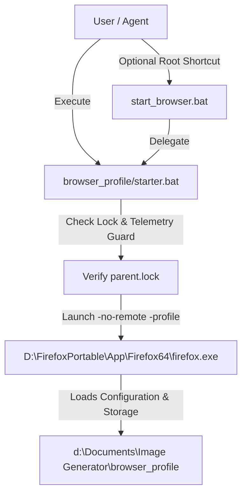

# PRODUCT REQUIREMENTS DOCUMENT (PRD)
## Image Generator — Browser Automation & Isolated Profile Environment

### 1. Overview
Workspace `Image Generator` dirancang untuk otomasi generasi gambar berbasis peramban (web-based AI image generation seperti Perchance, Midjourney, Flux, Leonardo, dsb.) dan utilitas terkait. Langkah fondasi pertama adalah menyiapkan lingkungan profil peramban terisolasi (`browser_profile`) berbasis Firefox Portable (`ulul_azmi`) dengan skrip peluncur (*starter*) langsung di dalam direktori profil.

### 2. Requirements & User Stories
- **Isolasi Penuh:** Pengguna membutuhkan profil peramban yang terisolasi dari instalasi utama agar sesi login, token, bookmark, dan ekstensi dapat digunakan khusus untuk proyek `Image Generator`.
- **In-Folder Starter:** Pengguna dapat langsung membuka folder profil dan mengeklik berkas starter (`starter.bat` / `start_browser.bat`) untuk meluncurkan peramban dengan parameter profil yang tepat (`-no-remote -profile "%~dp0"`).
- **Anti-Telemetry & Safe Run:** Menonaktifkan Mozilla Crash Reporter agar tidak menulis log atau membuang crash dump ke partisi `C:\`.

### 3. Core Features (MVP)
1. **Isolated Browser Profile Folder (`browser_profile`):**
   - Kloning dari `D:\FirefoxPortable\Data\profiles\ulul_azmi`.
   - Mengecualikan berkas kunci sementara (`parent.lock`) dan cache web berat (`cache2`) untuk menjaga portabilitas dan kecepatan I/O.
2. **Direct In-Folder Starter (`browser_profile\starter.bat` & `start_browser.bat`):**
   - Meluncurkan `D:\FirefoxPortable\App\Firefox64\firefox.exe`.
   - Menggunakan parameter otomatis `-no-remote -profile "%~dp0"`.
   - Mendukung argumen URL tambahan (`%*`).
3. **Workspace Root Launcher (`start_browser.bat`):**
   - Peluncur pintasan di tingkat root workspace yang mendelegasikan eksekusi ke `browser_profile\starter.bat`.

### 4. User Flow
1. Pengguna membuka folder `d:\Documents\Image Generator\browser_profile`.
2. Pengguna mengeklik ganda `starter.bat` (atau `start_browser.bat`).
3. Skrip memverifikasi ketersediaan biner Firefox Portable, membersihkan lock file usang jika ada, dan membuka Firefox dengan profil mandiri.
4. Pengguna dapat langsung berinteraksi dengan platform image generation dalam sesi yang persisten.

### 5. Architecture Diagram

### 6. File & Directory Layout
- `browser_profile/`: Direktori data profil Firefox (places, extensions, storage, prefs, logins).
- `browser_profile/starter.bat`: Peluncur langsung di dalam folder profil.
- `browser_profile/start_browser.bat`: Alias peluncur untuk kenyamanan pengguna.
- `browser_profile/starter.py`: Peluncur opsional berbasis Python dengan TUI Rich.
- `start_browser.bat`: Pintasan peluncur di root workspace.
- `.gitignore`: Mengabaikan `browser_profile/` dari pelacakan git.

### 7. Constraints & Guardrails
- Profil tidak boleh dilacak oleh Git karena berisi kredensial dan sesi peramban.
- Berkas `parent.lock` wajib dibersihkan agar tidak terjadi konflik multi-instance.
