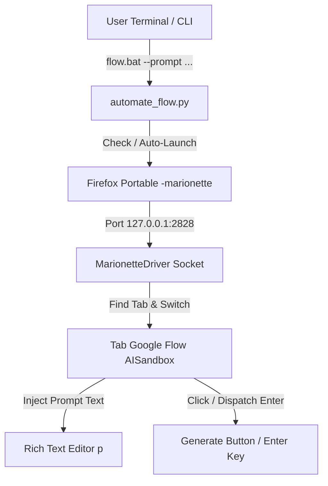

# PRODUCT REQUIREMENTS DOCUMENT (PRD)
## Image Generator — Browser Automation & Isolated Profile Environment

### 1. Overview
Workspace `Image Generator` dirancang untuk otomasi generasi gambar berbasis peramban (web-based AI image generation seperti Perchance, Midjourney, Flux, Leonardo, dsb.) dan utilitas terkait. Langkah fondasi pertama adalah menyiapkan lingkungan profil peramban terisolasi (`browser_profile`) berbasis Firefox Portable (`ulul_azmi`) dengan skrip peluncur (*starter*) langsung di dalam direktori profil.

### 2. Requirements & User Stories
- **Isolasi Penuh:** Pengguna membutuhkan profil peramban yang terisolasi dari instalasi utama agar sesi login, token, bookmark, dan ekstensi dapat digunakan khusus untuk proyek `Image Generator`.
- **In-Folder Starter:** Pengguna dapat langsung membuka folder profil dan mengeklik berkas starter (`starter.bat` / `start_browser.bat`) untuk meluncurkan peramban dengan parameter profil yang tepat (`-no-remote -profile "%~dp0"`).
- **Anti-Telemetry & Safe Run:** Menonaktifkan Mozilla Crash Reporter agar tidak menulis log atau membuang crash dump ke partisi `C:\`.

### 3. Core Features (MVP)
1. **Isolated Browser Profile Folder (`browser_profile`):**
   - Kloning dari `D:\FirefoxPortable\Data\profiles\ulul_azmi`.
   - Konfigurasi permanen `user.js` untuk port Marionette `127.0.0.1:2828`.
   - Mengecualikan berkas kunci sementara (`parent.lock`) dan cache web berat (`cache2`).
2. **Direct In-Folder Starter (`browser_profile\starter.bat` & `start_browser.bat`):**
   - Meluncurkan `D:\FirefoxPortable\App\Firefox64\firefox.exe`.
   - Menggunakan parameter otomatis `-no-remote -marionette -profile "%~dp0"`.
3. **Google Flow Automation Engine (`automate_flow.py` & `flow.bat`):**
   - Klien protokol Marionette native (zero-dependency socket client).
   - Pemindai otomatis tab aktif Google Flow (`aisandbox-root` / `flow-project-shell`).
   - Ekstraktor argumen `--prompt {teks}` yang menggabungkan seluruh kata tanpa memerlukan kurung tanda petik ganda.
   - Pemasukan prompt via `document.execCommand('insertText')` dan pemicuan tombol eksekusi / Enter.
   - Penyiapan arsitektur lanjutan untuk deteksi status generasi (Completed / InProgress / Failed).

### 4. User Flow
1. Pengguna membuka peramban melalui [browser_profile\starter.bat](file:///d:/Documents/Image%20Generator/browser_profile/starter.bat).
2. Pengguna membuka tab Google Flow ([https://labs.google/flow](https://labs.google/flow)) pada proyek yang diinginkan.
3. Pengguna mengeksekusi otomasi melalui CLI: `.\flow.bat --prompt gambar produk hidup`.
4. Skrip mendeteksi tab Google Flow, mengisi prompt pada editor kaya (*rich text editor*), menekan tombol *Generate* / mengirim *Enter*, lalu menampilkan status ringkasan eksekusi.

### 5. Architecture Diagram

### 6. File & Directory Layout
- `browser_profile/`: Direktori data profil Firefox (places, extensions, storage, prefs, logins).
- `browser_profile/starter.bat`: Peluncur langsung di dalam folder profil (-marionette).
- `browser_profile/start_browser.bat`: Alias peluncur untuk kenyamanan pengguna.
- `browser_profile/user.js`: Konfigurasi permanen port otomasi Marionette.
- `automate_flow.py`: Engine otomasi Google Flow.
- `flow.bat`: Pintasan runner batch.
- `.gitignore`: Mengabaikan `browser_profile/` dari pelacakan git.

### 7. Constraints & Guardrails
- Profil tidak boleh dilacak oleh Git karena berisi kredensial dan sesi peramban.
- Berkas `parent.lock` wajib dibersihkan agar tidak terjadi konflik multi-instance.
