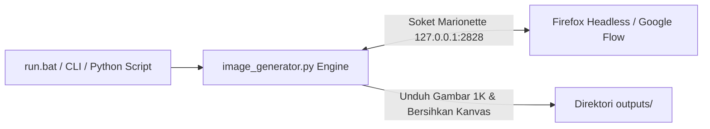

# Google Flow Image Generator 🎨🚀

> **Autonomous AI Image Generator Client for Google Flow.**  
> *100% Gratis, Tanpa Kuota Berbayar, Tanpa Mengganggu Kursor Pengguna (Zero Cursor Hijacking).*

---

## 🌟 Gambaran Sistem

Generator gambar AI otomatis yang bekerja langsung dengan antarmuka **Google Flow** secara senyap di latar belakang (*silent background*):



1. **Otomasi Latar Belakang:** Berkomunikasi langsung via protokol soket Gecko Marionette tanpa Selenium/WebDriver eksternal, sehingga tidak mengontrol mouse fisik maupun keyboard sistem (*zero cursor hijacking*).
2. **Siklus Lengkap:** Mengisi prompt, mengatur model AI & rasio layar, memantau progres pembuatan gambar hingga 100%, mengunduh resolusi asli 1K, dan membersihkan tile dari kanvas secara otomatis.

---

## ✨ Fitur Utama

- 💎 **100% Free & Unlimited:** Memanfaatkan Google Flow tanpa memerlukan kunci API berbayar atau langganan kuota.
- 🥷 **Silent Background & Zero Cursor Hijacking:** Beroperasi di latar belakang menggunakan komunikasi soket native Marionette murni. Anda bebas mengetik, bekerja, atau bermain game tanpa kursor mouse terganggu.
- 🔌 **Koneksi Soket Marionette:** Terhubung langsung ke peramban melalui port Marionette (`127.0.0.1:2828`) secara instan dan efisien.
- 📐 **Setelan Aspek Rasio Lengkap:**
  - `16:9` Widescreen Cinematic (`1376 × 768` px) — Thumbnail YouTube, Wallpaper.
  - `4:3` Klasik Landscape (`1152 × 896` px) — Presentasi, Layar Klasik.
  - `1:1` Square Persegi (`1024 × 1024` px) — Feed Instagram, Avatar, Logo.
  - `3:4` Formal Portrait (`896 × 1152` px) — Foto Profil, Portofolio.
  - `9:16` Smartphone Fullscreen (`768 × 1376` px) — TikTok, Shorts, Reels, Stories.
- 🧠 **Pilihan Model AI:** `pro` (Nano Banana Pro), `lite` (Nano Banana 2 Lite), dan `2.1` (Nano Banana 2.1).
- 🔢 **Variasi Gambar Fleksibel:** Menghasilkan 1 hingga 4 gambar per eksekusi (`x1`, `x2`, `x3`, `x4`).
- 🛡️ **Self-Healing & Auto-Retry Cerdas:** Mendeteksi status batas penggunaan atau kegagalan render, membersihkan kanvas (*clean slate*), dan mengulang proses secara mandiri hingga berhasil.
- 🧹 **Pembersihan Kanvas Otomatis:** Menghapus tile dari kanvas Google Flow (*Pindahkan ke sampah*) setelah gambar berhasil disimpan ke direktori lokal.
- 💻 **Antarmuka Terminal Modern:** Ditenagai Rich UI lengkap dengan progress spinner, tabel parameter, panel ringkasan, dan menu bantuan `--help`.
- 📦 **API Modul Python:** Dapat diimpor langsung (`from image_generator import generate, generate_image`) dengan type hints lengkap dan metadata `GenerationResult`.

---

## 📂 Struktur Repositori

```text
Image Generator/
├── debug/                      # Direktori dokumentasi saat flag --debug aktif
│   └── .gitkeep
├── outputs/                    # Direktori penyimpanan hasil unduhan gambar (1K)
│   └── .gitkeep
├── image_generator.py          # Modul inti Python & CLI Generator Gambar v1.0
├── run.bat                     # Runner batch Windows (klik ganda atau CLI)
├── requirements.txt            # Dependensi pustaka Python minimal (rich, Pillow)
├── LICENSE                     # Lisensi open-source MIT
├── .gitignore                  # Proteksi berkas lokal, cache, & direktori output
└── README.md                   # Dokumentasi resmi proyek
```

---

## 🚀 Panduan Memulai

### 1. Prasyarat
1. Pastikan peramban Firefox telah berjalan dengan opsi Marionette aktif (`127.0.0.1:2828`).
2. Pastikan akun Google Anda telah login dan dapat membuka layanan [Google Flow](https://labs.google/fx/tools/flow).

> **Tips:** Jika peramban belum berjalan, skrip ini dapat meluncurkan Firefox secara otomatis jika terdeteksi di lokasi standar (`D:\FirefoxPortable\App\Firefox64\firefox.exe`) atau melalui environment variable:
> - `FIREFOX_BIN`: Jalur ke berkas executable `firefox.exe`.
> - `BROWSER_PROFILE`: Jalur ke folder profil browser.

### 2. Instalasi Dependensi
Buka terminal pada folder proyek ini, lalu pasang dependensi:

```powershell
pip install -r requirements.txt
```

---

## 🎯 Cara Penggunaan

Tersedia 3 metode fleksibel sesuai kebutuhan Anda:

### Metode 1: Runner Windows (`run.bat`)
Paling praktis untuk pengguna desktop Windows:
- **Klik ganda (*Double Click*)** berkas [run.bat](file:///d:/Documents/Image%20Generator/run.bat).
- Masukkan teks prompt ketika diminta pada antarmuka terminal.
- Skrip akan memproses pembuatan gambar di latar belakang dan menyimpannya di folder `outputs/`.

Atau jalankan via PowerShell / Command Prompt dengan argumen langsung:
```powershell
.\run.bat -p "lukisan cat minyak pemandangan pegunungan fajar" -a 16:9 -m pro
```

---

### Metode 2: Baris Perintah Terminal (CLI)

Gunakan perintah `python image_generator.py` dengan opsi lengkap:

```powershell
# 1. Menampilkan Menu Bantuan Interaktif
python image_generator.py --help

# 2. Generasi Gambar Standar (Nano Banana Pro, Rasio 16:9, Variasi 1)
python image_generator.py -p "kucing putih anggora bermain di taman bunga sakura"

# 3. Kustomisasi Aspek Rasio (16:9, 1:1, 9:16, 4:3, 3:4)
python image_generator.py -p "cangkir kopi hangat latte art teratai" -a 1:1

# 4. Kustomisasi Model AI (pro, lite, 2.1)
python image_generator.py -p "mobil balap futuristik di sirkuit neon" -m pro -a 16:9

# 5. Kustomisasi Jumlah Variasi (1 sampai 4)
python image_generator.py -p "kastil fantasi megah di atas tebing bersalju" -c 2

# 6. Menentukan Folder atau Nama File Tujuan (-o / --output)
python image_generator.py -p "astronot menjelajahi gua kristal mars" -o "outputs/mars.jpg"

# 7. Mode Debug (Menyimpan tangkapan layar setiap langkah ke folder debug/)
python image_generator.py -p "burung merak bulu kristal bersinar" --debug
```

#### Tabel Opsi CLI

| Opsi Singkat | Opsi Panjang | Nilai Default | Deskripsi |
| :--- | :--- | :--- | :--- |
| `-p` | `--prompt` | *None* (Interaktif) | Teks prompt gambar |
| `-m` | `--model` | `pro` | Pilihan model: `pro` (Banana Pro), `lite` (Banana 2 Lite), `2.1` |
| `-a` | `--aspect-ratio`| `16:9` | Pilihan rasio: `16:9`, `4:3`, `1:1`, `3:4`, `9:16` |
| `-c` | `--count` | `1` | Jumlah variasi gambar: `1`, `2`, `3`, atau `4` |
| `-o` | `--output` | `outputs/` | Direktori atau nama berkas tujuan penyimpanan |
| `-t` | `--timeout` | `180` | Batas waktu tunggu render per percobaan (detik) |
| | `--headless` | `True` | Berjalan di latar belakang tanpa jendela GUI |
| | `--debug` | `False` | Simpan visual audit setiap langkah ke folder `debug/` |
| `-h` | `--help` | | Menampilkan antarmuka bantuan Rich lengkap |

---

### Metode 3: Modul Python (*Callable API*)

Impor langsung ke dalam proyek Python Anda:

```python
from image_generator import generate, generate_image

# -------------------------------------------------------------
# Contoh 1: generate_image() — Mengembalikan Path berkas lokal
# -------------------------------------------------------------
image_path = generate_image(
    prompt="pemandangan matahari terbenam di pantai tropis dengan siluet kelapa",
    aspect_ratio="16:9",
    model="pro",
    output_path="outputs/sunset.jpg"
)
print(f"Gambar berhasil dibuat: {image_path}")

# -------------------------------------------------------------
# Contoh 2: generate() — Mengembalikan objek GenerationResult
# -------------------------------------------------------------
result = generate(
    prompt="robot koki memasak sushi di dapur futuristik",
    aspect_ratio="1:1",
    model="pro",
    count=1,
    debug=False
)

if result.success:
    print(f"Status: Sukses ({result.duration_seconds:.1f} detik)")
    print(f"File: {result.image_path}")
    print(f"Dimensi/Ukuran: {result.aspect_ratio} ({result.file_size_human})")
    print(f"Model Engine: {result.model_name}")
else:
    print(f"Gagal: {result.error_message}")
```

---

## 📊 Matriks Aspek Rasio & Resolusi Google Flow

| Aspek Rasio | Dimensi Resolusi | Orientasi | Cocok Untuk |
| :---: | :---: | :---: | :--- |
| **`16:9`** | `1376 × 768` px | Landscape Widescreen | YouTube Thumbnail, Wallpaper Desktop, Banner Web |
| **`4:3`** | `1152 × 896` px | Klasik Landscape | Presentasi Slides, Foto Cetak Standar |
| **`1:1`** | `1024 × 1024` px | Square Persegi | Feed Instagram, Avatar Profil, Logo, Merchandise |
| **`3:4`** | `896 × 1152` px | Klasik Portrait | Foto Portofolio, Dokumen Vertikal |
| **`9:16`** | `768 × 1376` px | Vertical Fullscreen | Instagram Stories, TikTok, YouTube Shorts, Reels |

---

## 📄 Lisensi

Proyek ini dilisensikan di bawah lisensi open-source [MIT License](file:///d:/Documents/Image%20Generator/LICENSE).
